# Agente-Batalla-Naval

Proyecto final de **Representación y solución automática de problemas** (Universidad del Rosario).

Batalla Naval planteada como un problema de inteligencia artificial: un agente debe **encontrar y hundir una flota oculta** disparando casilla por casilla, con la menor cantidad de disparos posible. El proyecto incluye el entorno, varios agentes (búsqueda, Monte Carlo, red bayesiana y aprendizaje por refuerzo), una interfaz gráfica para jugar y visualizar el razonamiento de cada agente, y herramientas para compararlos experimentalmente.

---

## Contenido

1. [Características](#características)
2. [Estructura del proyecto](#estructura-del-proyecto)
3. [Instalación](#instalación)
4. [Ejecución](#ejecución)
5. [Capturas de pantalla](#capturas-de-pantalla)
6. [Niveles de dificultad](#niveles-de-dificultad)
7. [Agentes implementados](#agentes-implementados)
8. [Pruebas](#pruebas)
9. [Autores y licencia](#autores-y-licencia)

---

## Características

- **Entorno configurable** (`BatallaNavalEnv`): tamaño de tablero, flota, límite de disparos, ruido del sonar, adyacencia de barcos, sesgo de colocación y ocultamiento de la flota restante. Parcialmente observable, discreto y finito.
- **4 niveles de dificultad** (Fácil, Medio, Difícil, Experto) más **instancias personalizadas** creadas desde la interfaz.
- **6 agentes**: Aleatorio, Caza-Remate, MCTS (dos heurísticas), Bayesiano y DQN.
- **Interfaz gráfica (PySide6 + pygame)** con pestañas para jugar, ver razonar a un agente, explorar el árbol de MCTS, comparar algoritmos y editar instancias.
- **Visualización del estado interno** de cada algoritmo: mapas de calor, reglas activadas, árbol de búsqueda y valores Q.
- **Métricas experimentales**: victorias, disparos, eficiencia, optimalidad, recompensa acumulada, tiempo real y de CPU, nodos generados/expandidos y memoria.
- **Modo Humano vs. Máquina**: al terminar una partida, todos los agentes juegan la misma flota y se compara el resultado.
- **Notebook** que muestra la creación de una instancia, sus métodos y atributos, y la aplicación de los algoritmos.

---

## Estructura del proyecto

```
Agente-Batalla-Naval/
├── assets/                      # Sprites y fondo de la interfaz
├── models/                      # Pesos (.pt), logs (.csv) y curvas (.png) del DQN
├── docs/capturas/               # Capturas de pantalla usadas en este README
├── app_qt.py                    # Interfaz gráfica principal (punto de entrada)
├── ambientes.py                 # Entorno BatallaNavalEnv (estados, acciones, transición, objetivo)
├── dificultad.py                # Niveles de dificultad (ConfigDificultad)
├── instancia.py                 # Instancias personalizadas (guardar/cargar JSON)
├── editor_instancia.py          # Lógica del editor manual de flota
├── agents.py                    # Interfaz Agente, RandomAgent y AgenteCazaRemate
├── mcts_agent.py                # AgenteMCTS (Paridad+Colineal) y AgenteMCTSVecindad
├── bayes_agent.py               # AgenteBayesiano (Noisy-OR + marginales por barco)
├── dqn_agent.py                 # AgenteDQN (inferencia con red entrenada)
├── entrenar_dqn.py              # Entrenamiento Double DQN
├── evaluar.py                   # Evaluación por consola con semillas compartidas
├── comparar.py                  # Comparación de agentes y gráficas (usada por la GUI)
├── partida.py                   # Lógica de la partida humana
├── sesion_agente.py             # Sesión de un agente (reproducción paso a paso)
├── render_pygame.py             # Dibujo del tablero con sprites
├── visualizacion.py             # Utilidades de visualización
├── utils.py                     # Funciones auxiliares
├── test_instancias.py           # Pruebas de la lógica de instancias y comparación
├── Notebook_Batalla_Naval.ipynb # Notebook demostrativo
├── requirements.txt             # Dependencias
└── LICENSE
```

---

## Instalación

### Requisitos previos

- **Python 3.10 o superior** (probado con 3.12).
- `pip` y, recomendado, `git`.
- Un entorno gráfico (la interfaz usa Qt).

### Pasos

1. **Clonar el repositorio**

   ```bash
   git clone https://github.com/<usuario>/Agente-Batalla-Naval.git
   cd Agente-Batalla-Naval
   ```

   > Si se descargo el `.zip`, descomprímelo y entra a la carpeta del proyecto.

2. **Crear y activar un entorno virtual** (recomendado)

   ```bash
   python -m venv venv
   ```

   - Windows (PowerShell): `venv\Scripts\Activate.ps1`
   - Windows (CMD): `venv\Scripts\activate.bat`
   - Linux / macOS: `source venv/bin/activate`

3. **Instalar las dependencias**

   ```bash
   pip install -r requirements.txt
   ```

   Esto instala `numpy`, `matplotlib`, `pandas`, `pygame-ce`, `PySide6`, `torch` y `jupyter`.

   > **Nota:** `torch` Solo es necesario para ejecutar el agente DQN

---

## Ejecución

### Interfaz gráfica

```bash
python app_qt.py
```

La ventana tiene cinco pestañas:

| Pestaña | Qué hace |
|---|---|
| **Jugar** | Juegas tú contra el tablero. Al terminar, *Comparar con los agentes* hace jugar a todos los agentes sobre la misma flota y muestra tu puesto. |
| **Ver agente** | Observa a un agente jugar con animaciones y controles de reproducción (*Reproducir/Pausa*, *Paso adelante*, *Atrás*, *Terminar*, *Velocidad*). Muestra el mapa de calor y el estado interno (reglas de Caza-Remate, valores Q del DQN, etc.). |
| **Árbol MCTS** | Dibuja el subárbol explorado por MCTS en cada jugada: raíz, rama seleccionada, nodos expandidos y nodos frontera. |
| **Comparar** | Ejecuta varios agentes sobre las mismas semillas en un hilo aparte, con tabla de métricas, gráficas y exportación a CSV. |
| **Editor de instancias** | Configura el tablero y la flota, coloca los barcos a mano y guarda/carga la instancia en JSON. Aparece como nivel **Personalizada** en las demás pestañas. |

**Controles del editor:** clic = colocar, clic sobre un barco = moverlo, clic derecho = quitarlo, `R` o rueda del ratón = girar horizontal/vertical.

### Entrenamiento del agente DQN

Los modelos para `facil`, `medio` y `dificil` ya están en `models/`. Para entrenar o reentrenar:

```bash
python entrenar_dqn.py --nivel facil --episodios 3000
python entrenar_dqn.py --nivel medio --episodios 3000 --desde models/dqn_facil.pt --eps-inicial 0.3
python entrenar_dqn.py --nivel dificil --dispositivo cuda --batch 256 --actualizar-cada 4
```

Se genera `models/dqn_<nivel>.pt` (pesos), `models/dqn_<nivel>_log.csv` (curva de aprendizaje) y `models/dqn_<nivel>.png` (gráfica). Ejecuta `python entrenar_dqn.py --help` para ver todos los parámetros.

> El nivel **Experto** no tiene modelo DQN entrenado; en ese nivel (y en instancias personalizadas) el DQN se omite y los demás agentes funcionan con normalidad.

## Capturas de pantalla

### Pestaña «Jugar»

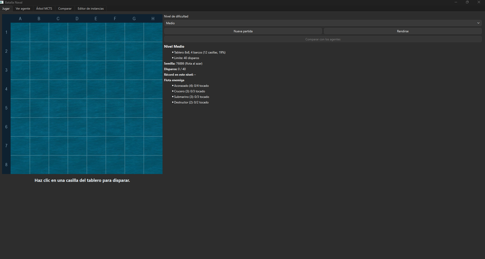

### Comparación Humano vs. Máquina

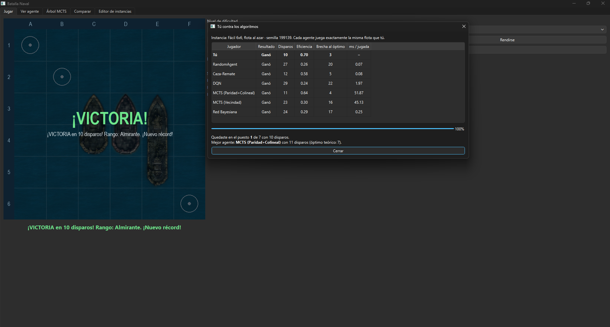

### Pestaña «Ver agente» — Caza-Remate

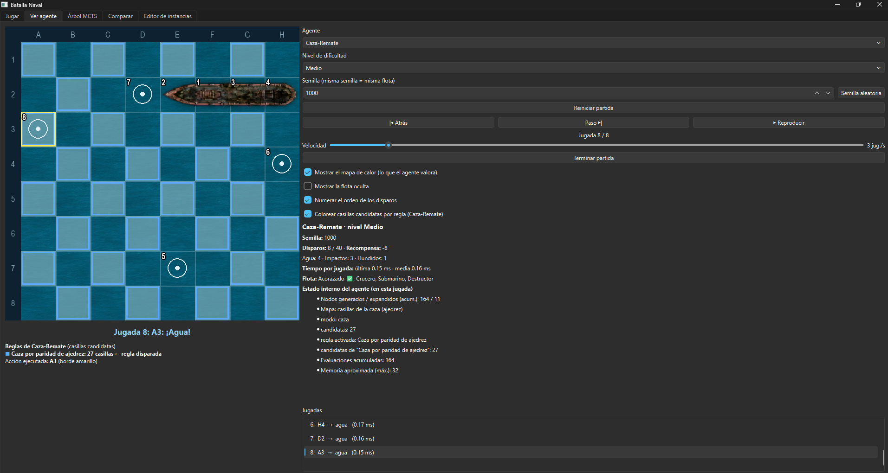

### Pestaña «Ver agente» — Mapa de calor (Bayesiano)

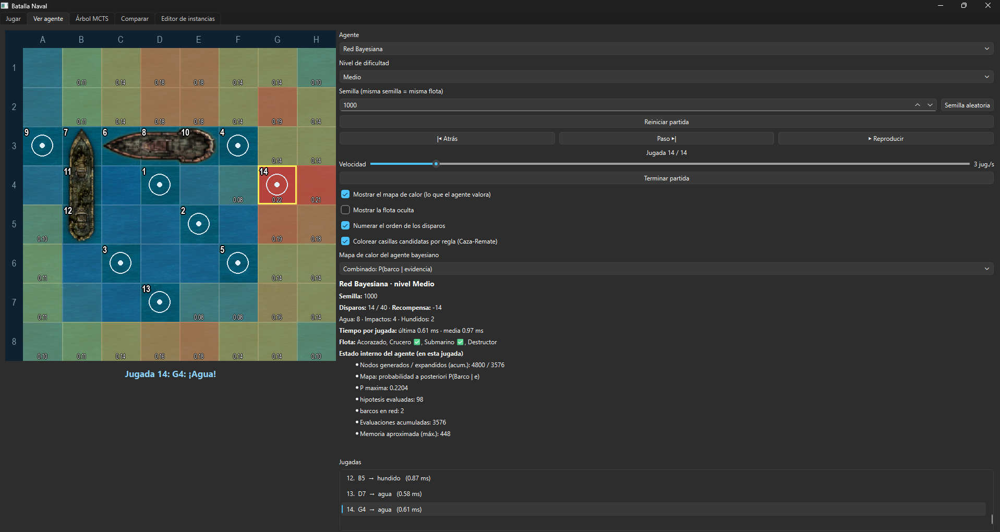

### Pestaña «Ver agente» — DQN

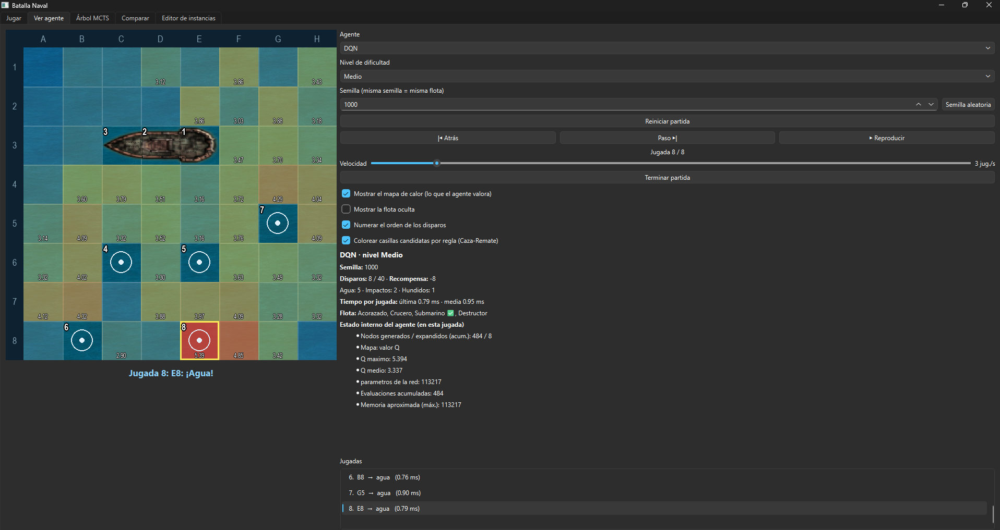

### Pestaña «Árbol MCTS»

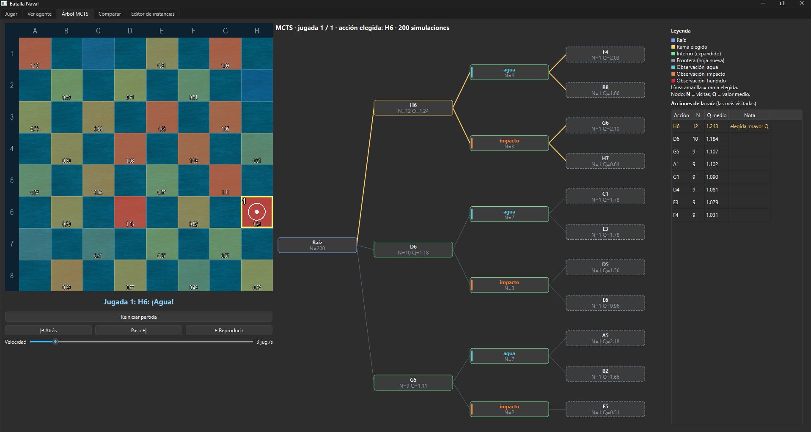

### Pestaña «Comparar» — Gráficas

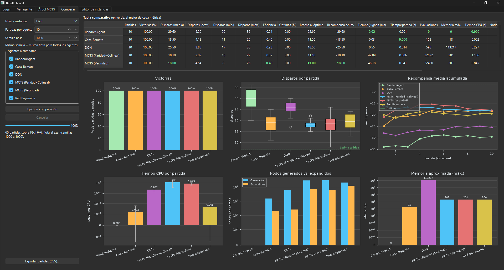

### Pestaña «Editor de instancias»

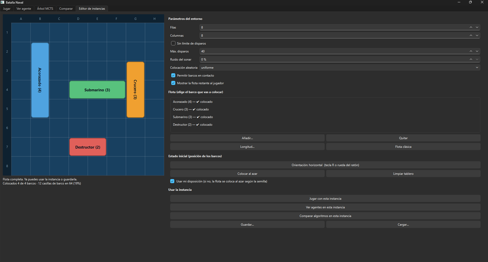

### Curvas de entrenamiento del DQN

Generadas automáticamente por `entrenar_dqn.py`:

| Fácil | Medio | Difícil |
|:---:|:---:|:---:|
| 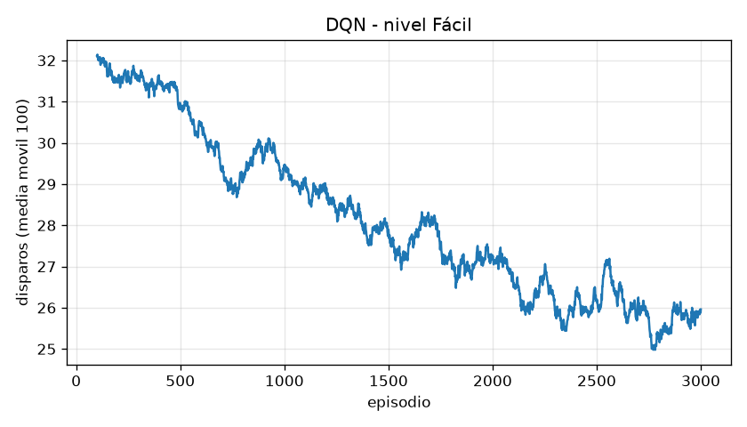 | 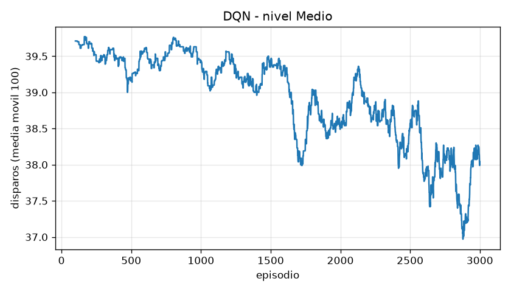 | 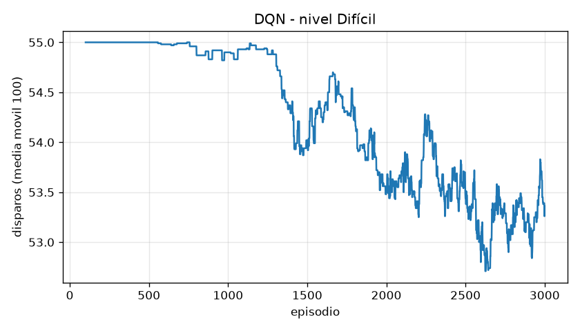 |

---

## Niveles de dificultad

La dificultad es una **configuración del entorno**: una persona y cualquier agente enfrentan exactamente el mismo problema en el mismo nivel.

| Nivel | Tablero | Flota | Límite de disparos | Particularidades |
|---|---|---|---|---|
| **Fácil** | 6×6 | Crucero (3), Destructor (2), Lancha (2) | Sin límite | — |
| **Medio** | 8×8 | Acorazado (4), Crucero (3), Submarino (3), Destructor (2) | 40 | — |
| **Difícil** | 10×10 | Flota clásica (5, 4, 3, 3, 2) | 55 | Flota restante oculta |
| **Experto** | 12×12 | Flota clásica (5, 4, 3, 3, 2) | 80 | Flota restante oculta, sonar con 6 % de error |
| **Personalizada** | Libre | Libre | Libre | Creada en el *Editor de instancias* |

---

## Agentes implementados

Todos heredan de `Agente` y solo ven la observación que entrega el entorno (nunca el tablero oculto).

| Clave | Agente | Descripción |
|---|---|---|
| `aleatorio` | `RandomAgent` | Dispara a casillas desconocidas al azar. Línea base. |
| `caza` | `AgenteCazaRemate` | Reglas: caza por paridad de ajedrez, remate ortogonal tras un impacto y remate colineal con impactos alineados. |
| `mcts` | `AgenteMCTS` | Monte Carlo Tree Search con paridad adaptativa al barco mínimo vivo y remate colineal. |
| `mcts_vecindad` | `AgenteMCTSVecindad` | MCTS con vecindad ortogonal simple, sin paridad ni colinealidad (segunda heurística para comparar). |
| `bayes` | `AgenteBayesiano` | Red bayesiana con Noisy-OR y probabilidades marginales por barco. |
| `dqn` | `AgenteDQN` | Double DQN con red convolucional y enmascarado de acciones ilegales; requiere modelo en `models/`. |

Para agregar un agente nuevo: heredar de `agents.Agente`, implementar `make_decision` (y opcionalmente `estado_interno`) y registrarlo en `agents.AGENTES`.

---


## Autores y licencia

Proyecto desarrollado por: Sebastián Rojas – Juan Felipe Rojas – Juan Diego Jiménez

Universidad del Rosario — Representación y solución automática de problemas.

Distribuido bajo la licencia incluida en el archivo [`LICENSE`](LICENSE).